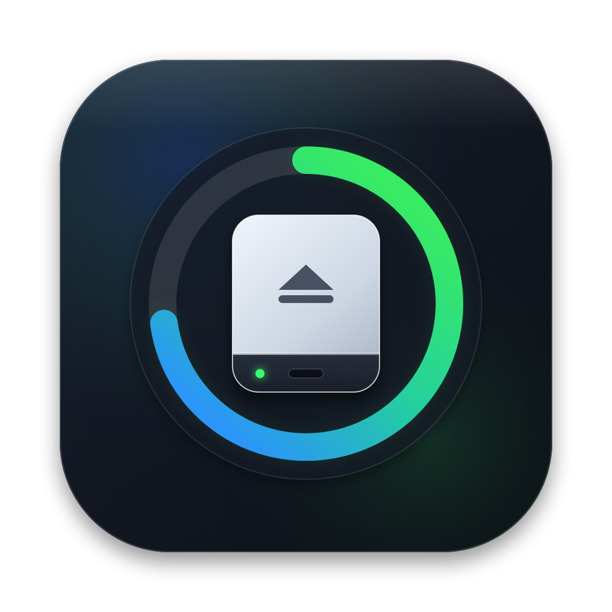
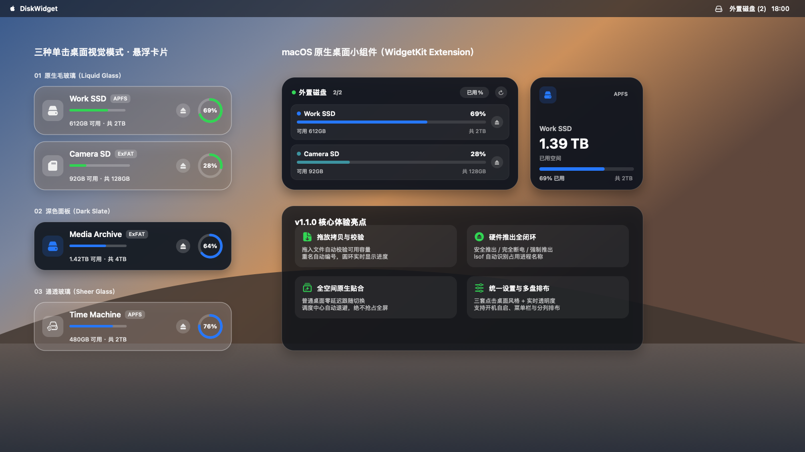
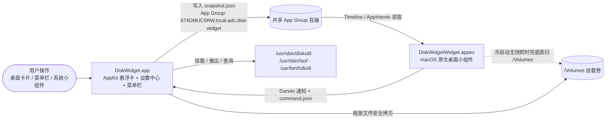
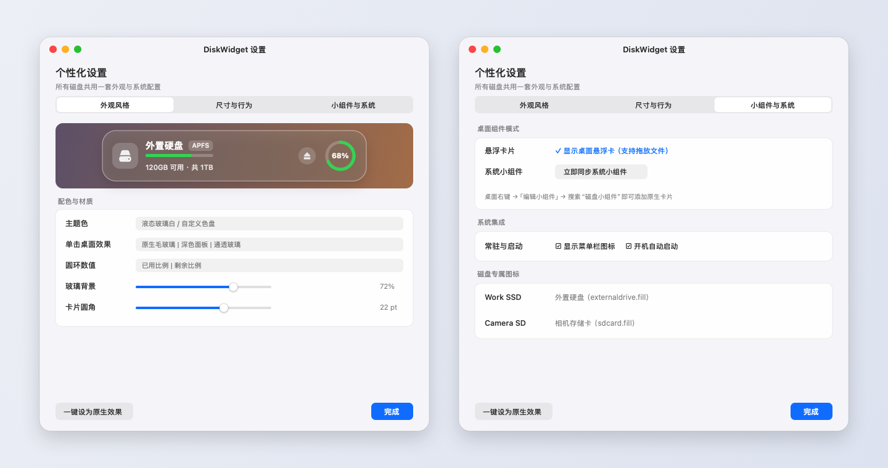

<div align="center">



# DiskWidget

**为 macOS 打造的原生外置磁盘桌面小组件 · 悬浮毛玻璃卡片 + 原生 WidgetKit 扩展**

[](#构建与测试)
[](#安装与使用)
[](https://github.com/adcheun/disk-widget/releases/latest)
[](SECURITY.md)

[功能特性](#核心功能) · [效果预览](#效果预览) · [架构与交互](#架构与交互) · [安装与使用](#安装与使用) · [构建与测试](#构建与测试) · [隐私与安全](#隐私与安全)

</div>

---

**DiskWidget** 是一个纯原生 Swift（AppKit + SwiftUI / WidgetKit）实现的 macOS 外置磁盘桌面管理与监控工具。它将连接的外置 SSD、U 盘、SD 卡、安装镜像（DMG/ISO）和 Time Machine 备份盘以「桌面悬浮毛玻璃卡片」和「macOS 系统原生小组件」两种形态常驻桌面，支持文件拖放拷贝、字节级进度圆环、占用进程排查与一键推出。

> 本项目所有截图、文档与测试均使用通用示例名称与数据，不在仓库中留存或展示任何个人硬盘名称、序列号或本地路径。

---

## 效果预览

### 桌面悬浮卡片 & 原生 WidgetKit 系统小组件



- **左侧 · 桌面悬浮卡片**：提供 **原生毛玻璃（Liquid Glass）**、**深色面板（Dark Slate）** 与 **通透玻璃（Sheer Glass）** 三种单击桌面风格，并支持滑块实时预览背景透明度、圆角与字号；内建 `APFS` / `ExFAT` 格式徽章、状态等宽进度条、卡片内弹出按钮与容量仪表圆环。
- **右侧 · 原生 WidgetKit 小组件**：内置 `DiskWidgetWidget.appex`（支持 `外置磁盘总览` 小/中/大尺寸与 `指定外置磁盘` 卡片），深色玻璃底板兼顾系统“编辑小组件”预览与桌面激活/非激活玻璃态，支持一键切换 `已用% / 剩余%`、快捷刷新与安全推出。

---

## 核心功能

| 模块 | 能力亮点 |
| --- | --- |
| **双形态桌面展示** | 同时提供可拖放交互的 **桌面悬浮卡** 与 macOS 14+ **原生系统小组件（WidgetKit）**，可在设置中自由搭配或单独关闭悬浮卡。 |
| **三种单击桌面质感** | 统一所有磁盘卡片的激活效果：`原生毛玻璃`（`NSGlassEffectView` + 翡翠绿点缀）、`深色面板`、`通透玻璃`，并支持“桌面融合”失焦柔和淡化。 |
| **拖放极速拷贝** | 直接把文件或文件夹拖放到可写磁盘卡片上即可复制到根目录，自动校验剩余空间并拦截只读卷；重名项目自动编号覆盖保护；圆环实时展示进度与取消按钮，复制完 4 秒内单击卡片可在 Finder 高亮定位文件。 |
| **硬件推出全闭环** | 卡片内快速「安全推出」，右键提供「完全推出（断电移除）」及「重新连接」；遇到进程占用时自动调用 `/usr/sbin/lsof` 识别占用进程名称（如 `Finder`），并提供带二次确认的「强制推出…」。 |
| **多空间零延迟贴合** | 通过 `.canJoinAllSpaces + .stationary + .fullScreenNone` 严格锁定在普通桌面空间：全屏应用切回桌面时卡片跟随壁纸零延迟出现；四指上扫进入调度中心时自动退避隐藏；打开/关闭设置面板不会错误跳转到全屏应用空间。 |
| **多盘分列与个性化** | 支持菜单栏图标常驻、一键全部推出（`⌘E`）、`SMAppService` 开机自启、按住 `⌥` 拖拽卡片重排、按卷 UUID 设置本地别名与专属图标（硬盘 / SD 卡 / 相机 / 镜像 / Time Machine），多盘超屏时自动分列排布。 |

---

## 架构与交互



---

## 设置中心预览



统一设置窗口按三大标签页组织，避免频繁弹窗并保留完整微调入口：
1. **外观风格**：实时壁纸卡片预览、`主题色`（内置预设 + `NSColorWell` 自定义）、`单击桌面效果` 切换、`圆环数值`、`玻璃背景` 透明度实时预览、`卡片圆角` 与三组字号调整。
2. **尺寸与行为**：卡片宽/高/间距、进入「高级布局微调…」独立调整图标/文本/圆环/按钮坐标、DMG/ISO 安装镜像显示位置切换、非激活桌面自动柔和淡化开关。
3. **小组件与系统**：桌面悬浮卡开关、一键同步系统小组件、菜单栏图标与 `SMAppService` 开机自启开关、按卷 UUID 指定每张盘的专属图标。

---

## 安装与使用

### 直接下载安装包（推荐）

前往 [GitHub Releases](https://github.com/adcheun/disk-widget/releases) 下载最新 Apple Silicon 构建包 `DiskWidget-1.1.0-macOS-arm64.zip`：

1. 解压后将 `DiskWidget.app` 拖入「应用程序」文件夹并打开。
2. 在桌面上右键 →「编辑小组件」→ 搜索 **“磁盘小组件”** 即可添加原生桌面小组件（支持 macOS 14+）。
3. 在菜单栏或右键卡片 →「设置… → 小组件与系统」中勾选「开机自动启动」。

### 快捷交互指南

| 操作 | 触发方式 |
| --- | --- |
| **在 Finder 中打开磁盘** | 双击磁盘卡片，或在系统小组件中直接点击磁盘行 |
| **切换已用% / 剩余%** | 单击桌面卡片右侧的容量圆环，或点击系统小组件右上角切换按钮 |
| **移动整组 / 调整顺序** | 直接拖动移动整组位置；按住 `Option (⌥)` 拖拽单张卡片重排顺序 |
| **拷贝文件到磁盘** | 将文件/文件夹拖放到已连接的可写卡片上，拷贝中可点击停止取消 |
| **安全推出 / 完全推出 / 强制推出** | 单击卡片内弹出按钮安全推出；右键菜单支持「完全推出（断电移除）」、「强制推出…」与「一键推出所有外置磁盘」 |
| **自定义图标与别名** | 右键单张卡片或打开「设置… → 小组件与系统」指定本地别名与专属图标 |

---

## 构建与测试

环境要求：macOS 13 或更高版本（WidgetKit 系统小组件需 macOS 14+）、Xcode Command Line Tools 与 Swift 编译器。

### 一键完整构建（主应用 + WidgetKit 扩展 + 应用图标 + 签名）

```sh
./build.sh
open ./DiskWidget.app
```

[build.sh](build.sh) 会自动编译 `DiskWidget` 主程序与 `DiskWidgetWidget.appex` 扩展、抽取 `Metadata.appintents`、嵌入 [AppIcon.icns](Assets/AppIcon.icns)，并签名及向 LaunchServices / `pluginkit` 注册扩展；若本机不存在 `Apple Development` 证书，将自动回退本地证书或 ad-hoc 签名。

如需重新生成应用图标资源，可执行：

```sh
swift Assets/generate_icon.swift Assets/AppIcon.png
```

### 运行自动化回归测试

```sh
python3 tests/run_window_regressions.py
python3 tests/run_widget_tests.py
```

测试脚本全部运行在独立的临时 `UserDefaults` 测试域与虚拟面板下，不读取本机真实硬盘信息、也不会修改应用已有设置。窗口多空间与调度中心动画行为说明见 [窗口行为说明](docs/window-behavior.md)。

---

## 隐私与安全

- **零网络通信**：无 `URLSession`、无统计埋点、无账号体系或远程下载，所有逻辑 100% 本地执行。
- **最小权限边界**：仅调用系统自带 `/usr/sbin/diskutil`、`/usr/bin/hdiutil`、`/usr/sbin/lsof`（只读查询占用进程）和 `/usr/bin/osascript`（仅在主动点击“显示简介”时呼出 Finder 简介框），所有进程均使用固定路径与数组参数传参，不拼接执行任何 shell 命令。
- **沙盒与容器隔离**：WidgetKit 扩展运行于 Apple App Sandbox（`com.apple.security.app-sandbox`），仅通过 App Group 共享只读状态快照与指令队列。

完整安全审计说明见 [SECURITY.md](SECURITY.md)。

---

## 项目结构

```text
mac-disk-widget/
├── DiskWidget.swift                 # 主应用源码（悬浮卡、拖放传输、菜单栏、设置中心与多空间管理）
├── Shared/
│   └── DiskWidgetSnapshot.swift     # 主应用与 WidgetKit 扩展共享的快照与指令模型
├── WidgetExtension/
│   ├── DiskWidgetExtension.swift    # 原生 WidgetKit 桌面小组件与 AppIntents
│   └── Info.plist
├── Entitlements/
│   ├── Host.entitlements            # 主应用 App Group 权限声明
│   └── WidgetExtension.entitlements # 小组件扩展沙盒与 App Group 权限声明
├── Assets/
│   ├── generate_icon.swift          # 原生 1024×1024 应用图标渲染脚本
│   ├── AppIcon.png                  # 高清应用图标预览
│   └── AppIcon.icns                 # 打包用 macOS 应用图标集
├── docs/                            # 图文预览与窗口行为文档
├── tests/                           # 窗口布局与 WidgetKit 桥接自动化测试
├── build.sh                         # 一键构建、Metadata 提取与签名注册脚本
├── DiskWidget.app/                  # 当前已签名构建产物
├── README.md
└── SECURITY.md
```

---

## 许可证

暂未指定开源许可证。如需修改、二次分发或商业使用，请先补充对应 `LICENSE` 文件。
