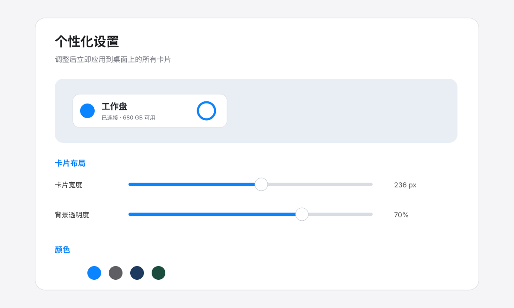

# DiskWidget

一个原生 Swift/AppKit macOS 桌面磁盘小组件。它把外置硬盘和 U 盘显示为桌面卡片，支持双击打开、拖放复制文件、安全推出、重新连接、自动检测新设备和统一布局调整。

## 功能

- 自动显示当前已挂载的外置硬盘和 U 盘，不在项目中保存或展示特定用户的卷名、容量或路径。
- 显示已用/剩余空间比例（支持单击容量圆环或设置内一键切换）、可用容量、文件系统格式（如 `APFS` / `ExFAT` / `NTFS`）和连接状态。
- 原生 macOS 小组件质感：采用连续平滑圆角（`.continuous`）、贴合圆角的毛玻璃阴影遮罩（`maskImage`）、深浅色自适应高光内描边，以及可选的“桌面融合（使用其他应用时自动柔和淡化）”模式。
- 硬件推出闭环：点击推出按钮安全卸载/推出；若磁盘被后台应用占用导致推出失败，自动通过 `/usr/sbin/lsof` 识别占用进程名称（如 `Finder`、`Spotlight 索引`），并在右键菜单提供带二次确认的“强制推出…”。
- 透明可控的拖放文件传输：将文件或文件夹拖到可写卡片即可复制到卷（重名自动编号不覆盖）；复制前自动校验剩余可用空间，只读卷自动拦截并提示原因；复制期间圆环实时显示字节级传输进度并支持中途取消，复制完成后单击卡片即可在 Finder 中高亮定位新文件。
- 多盘效率与个性化：菜单栏图标实时列出所有已挂载外置卷及容量，支持“一键安全推出所有外置磁盘（⌘E）”；每张卡片支持按卷 UUID 设置非破坏性本地别名与专属图标（自动识别 / 硬盘 / SD 卡 / 相机 / 镜像 / Time Machine）；多盘超屏时自动向旁侧分列排布。
- 零门槛配置体验：支持 macOS 13+ 原生“开机自动启动”开关（`SMAppService`）；未接入外置硬盘时打开设置窗口，桌面会自动展示可拖拽的实时预览占位卡。
- 在普通桌面显示，进入调度中心（四指上滑）时隐藏，退出后恢复；保持在普通应用窗口下方；多显示器热插拔时保留用户原有位置。

## 构建

要求 macOS 13 或更高版本、Xcode Command Line Tools 和 Swift 编译器。

```sh
./build.sh
open ./DiskWidget.app
```

也可以直接运行：

```sh
swiftc DiskWidget.swift -o DiskWidget.app/Contents/MacOS/DiskWidget -framework AppKit
```

可在“DiskWidget 设置 → 系统集成”中直接勾选“开机自动启动”，或在系统设置的“登录项”中加入 `DiskWidget.app`。

窗口行为回归测试（需 macOS、Swift 和 Python 3）：

```sh
python3 tests/run_window_regressions.py
```

测试使用独立设置域和虚拟卡片，不读取个人磁盘名称，也不覆盖应用设置。调度中心的实际隐藏动画需在桌面环境另行验证，见 [窗口行为修复记录](docs/window-behavior.md)。

## 使用说明

1. 启动应用后，当前已挂载的外置卷会显示在桌面；若未接入外置盘，打开“设置…”时桌面会显示一张临时预览卡片供调整位置和尺寸。
2. 拖动卡片可调整位置；普通拖动移动整组，按住 Option 可调整单张卡片顺序。
3. 双击卡片打开 Finder；单击右侧容量圆环可在“已用百分比”与“剩余百分比”间切换；悬停圆环可查看文件系统格式与完整容量提示。
4. 右键卡片打开菜单：可在 Finder 中打开、显示简介、设置卡片本地别名、切换专属卡片图标、安全推出、完全推出、强制推出（解决占用）、一键推出所有外置盘或打开统一组件设置。
5. 将文件或文件夹拖到已连接的可写卡片上即可复制到对应卷，复制中可点击停止按钮取消，复制完成后 4 秒内单击卡片可直接定位文件。
6. 点击推出图标安全移除设备；设备重新插入后会自动恢复，或在卡片/菜单栏中选择“重新连接”。

## 界面预览

以下图片使用通用示例名称和示例数据，不包含任何用户硬盘信息。

### 小组件主界面


### 个性化设置



### 高级设置


## 权限与隐私

应用不联网、不收集数据、不写入账号或凭据。它只读取本机卷信息，并将布局、卷 UUID、卡片本地别名/图标和卡片顺序写入当前用户的 `UserDefaults`。

安全推出、挂载、占用查询使用系统自带的 `/usr/sbin/diskutil` 与 `/usr/sbin/lsof`，参数由应用根据当前卷标识生成，不执行用户输入的 shell 字符串。拖放复制仅在用户主动拖入后发生，目标是当前卡片对应的卷。

“显示简介”功能通过 macOS 自带 `osascript` 请求 Finder 打开原生信息窗口，因此首次使用时 macOS 可能要求在“系统设置 → 隐私与安全性 → 自动化”中允许 DiskWidget 控制 Finder。应用不会读取或上传 Finder 内容。

完整审查记录见 [SECURITY.md](SECURITY.md)。

## 项目结构

- `DiskWidget.swift`：当前发布源码（基于无改名版）。
- `DiskWidget.app/`：本机已构建的应用包。
- `build.sh`：可复现构建脚本。
- `docs/`：界面预览和窗口行为说明。
- `tests/`：窗口与布局回归测试。
- `release/`：当前发布包（旧版包归档在 `archive/releases/`）。
- `archive/legacy-sources/`：历史源码版本，仅用于追溯，不参与构建。
- `backups/`：本机更新前的恢复备份，不纳入发布包。

## Release

Release 包为 Apple Silicon macOS 构建，下载后将 `DiskWidget.app` 拖入“应用程序”，再到设置中开启“开机自动启动”即可。源码和构建脚本仍然包含在仓库中。

## 许可证

暂未指定开源许可证。若要允许他人修改、分发或商用，请在发布前补充 LICENSE 文件。
